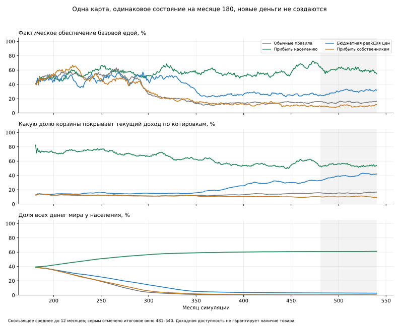

# Почему население теряет покупательную способность

**Найдены два влияющих механизма: накопление денег сверх обязательств на счетах
предприятий и слабая реакция цен базовых товаров на бюджет населения.** Возврат
доступной текущей прибыли населению дал больший эффект, чем проверенная ценовая
поправка. Выплата той же доли прибыли прежним собственникам на первой карте
не улучшила питание населения. Это исследование механизмов, не готовая политика.

Экономические вмешательства **не включены в игру**. В основной код перенесено
только обнаруженное исправление освобождения резерва при допустимой погрешности
цены. Оно описано ниже отдельно.

## Что считали

Первая карта — seed 73129, checkpoint месяца 180 из серии `fresh-73129`.
Во всех вариантах действует исправленное игровое планирование склада. Каждый
опыт продолжается 360 месяцев до месяца 540. Основной исход — среднее обеспечение
базовой едой за последние 60 месяцев, 481–540, по одинаковым начальным ценам
товаров. Дизайн записан до результатов в `/workspace/money-cycle-pilot/design.json`.

Дополнительно измеряются:

- **Доходная доступность:** какую долю полного базового набора может оплатить
  месячный входящий доход каждого домохозяйства по котировкам этого месяца,
  без использования начальной кассы. Доли ограничены 100% и взвешены базовой
  потребностью. Текущие выплаты приходят после торгов; показатель диагностический,
  не использование будущих денег при выставлении заявок.
- **Денежные потоки:** доходы, расходы, изменения счетов секторов, деньги сверх
  рабочих и проектных резервов. Проверяется сохранение золота.
- **Воспроизводство:** фактическое потребление, выпуск всех товаров, склады,
  обеспеченные заявки и сохранность отраслей. Оборот или номинальный доход сами
  по себе не считаются успехом.

Полная корзина оценивается даже при наличии старого склада; накопления не
считаются доходом. Котировка включает доставку и может использовать игровые
ориентиры будущего предложения при недостатке текущего. Доступность по ней
не гарантирует наличие товара. Фактическое потребление измеряется отдельно.

## Четыре варианта первой карты

1. **Контроль:** обычные игровые правила.
2. **`profit_income`:** 100% доступной текущей положительной учётной прибыли
   предприятий направляется домохозяйствам того же государства пропорционально
   населению, вместо дивидендов владельцам. Платёж ограничен собственной кассой
   после рабочих и проектных резервов. Старую накопленную кассу целиком не
   распределяют, золото не создают. Показатель `dividends` в эксперименте означает
   выплату из прибыли; фактические получатели отмечены как `household`.
3. **`budget_prices`:** к обычному обновлению цен добавляется снижение цен базовых
   товаров к взвешенной медиане бюджетной цены домохозяйств предыдущего месяца,
   за вычетом доставки. Вес — требуемое к покупке количество. Снижение ограничено
   обычным шагом 5% и существующим нижним пределом. Учитываются и обеспеченные,
   и недофинансированные потребности; недоступные маршруты исключены. Допускается
   реакция при положительных прошлых продажах. Остальные товары, доходы и порядок
   торговли не меняются. Это не простая замена каждого `max` на медиану: добавлен
   отдельный приоритет бюджетного сигнала населения для базовых товаров.
4. **`owner_profit`:** дополнительный контроль распределения. Та же ставка 100%
   доступной текущей прибыли выплачивается прежним владельцам. Рабочие и
   проектные резервы защищены тем же обычным расчётом. Фактические суммы между
   сценариями не фиксированы: прибыль меняется вместе с экономикой. В контроле
   ставка дивидендов — 50%. Этот вариант отделяет повышение ставки от смены
   получателя при полной выплате, но не подбирает оптимальную долю распределения.

Дополнительный контроль владельцев добавлен до результатов пилота, после чтения
правила дивидендов. Все варианты начинают с одинакового состояния и RNG.
Получение прибыли населением — существенное изменение распределения доходов и
будущего финансирования владельцев, а не нейтральное исправление бухгалтерии.

## Результаты первой карты

Средние значения в месяцах 481–540:

| Вариант | Базовое обеспечение | Корзина на текущий доход | Касса населения в конце | Чистый поток населения в месяц |
|---|---:|---:|---:|---:|
| Контроль | 15,25% | 15,55% | 353 | −8 |
| Прибыль населению | 60,02% | 54,52% | 1071614 | +105 |
| Бюджетная реакция цен | 30,56% | 39,90% | 47808 | −92 |
| Прибыль прежним владельцам | 9,80% | 10,22% | 6184 | −26 |

При выплате прибыли населению касса в последнем окне не убывает. Это существенно
отличается от увеличения потребления за счёт расходования накоплений. Однако
доходная доступность ниже полной корзины, фактическое питание не полное,
устойчивость на бесконечном горизонте не доказана.

При ценовой поправке население всё ещё тратит больше, чем получает. Она смягчает
проблему, но не закрывает денежный контур самостоятельно на проверенном горизонте.



На графике сглаживание до 12 месяцев, итоговое окно выделено серым. Исходные
несглаженные значения доступны в CSV.

## Где оседают деньги

В контроле за 360 месяцев:

| Сектор | Изменение кассы |
|---|---:|
| Домохозяйства | −679439 |
| Предприятия | +1090164 |
| Частные собственники | −297977 |
| Торговцы | −90315 |
| Муниципальные владельцы | +13904 |
| Казна | −36305 |

Небольшой остаток относится к перевозчикам и округлениям таблицы. Полная сумма
секторных изменений равна нулю в пределах численной точности.

В конце у предприятий **1699828 золота — 97,27% всей денежной массы**.
Из них около **1655527 сверх рассчитанных рабочих и проектных обязательств**.
Это не просто необходимые средства на следующую закупку или текущую стройку.
Само накопление не объявляется ошибкой: проблема в том, что в этой модели
обратных потоков к конечным покупателям недостаточно.

Средний месячный доход населения в последнем окне контроля — 431: зарплата 115,
транспортные услуги 33, общественные услуги 283. Эти потоки не поддерживают
необходимый набор покупок при текущих ценах. Удержание положительной прибыли
ограничено дивидендами, а инвестиции не возвращают достаточно денег населению
в наблюдаемой ситуации с обедневшим спросом.

В опыте с выплатой прибыли населению касса предприятий выросла лишь на 17429
за весь горизонт, а не на 1090164. Основная масса первоначальной кассы фирм
при этом не изымалась: в конце там осталось 627093. Новые деньги не создавались.
На той же карте в конце работают все товарные отрасли по среднему выпуску
последних 60 месяцев; в контроле у руды и железа выпуск нулевой.

Важная деталь конфигурации: поле `owner_distribution: 0.20` остаётся в
`content/economy.json`, но текущая V3 его не читает. Оно не означает, что 20%
дохода собственников уже возвращается домохозяйствам. Используемые механизмы —
реальные дивиденды, личные покупки владельцев и выплаты казны/перевозчиков.

## Почему выплаты владельцам и дешёвая цена не равны улучшению питания

Счета владельцев отделены от домохозяйств. Их личное потребление также считается
отдельно. В `owner_requests()` расходуется доля свободной кассы на хлеб, рыбу и
ткань; количество не ограничено популяционной нормой потребности владельца.

В `owner_profit` общий выпуск хлеба в последнем окне — 1229 в месяц, больше
контрольных 575. Но населению достаётся 163 вместо 251: покупательная способность
и потребление перераспределились к владельцам. Номинальный доход населения
вырос до 2400, однако котируемая базовая корзина выросла до 23913 против 2803
в контроле. Поэтому номинальное увеличение выплат само по себе вводит в заблуждение.
Это результат конкретного опыта на первой карте, не доказательство вреда любых
дивидендов или любой частной собственности.

Ценовая поправка тоже имеет побочные эффекты. В контроле средняя котировка
доставленной рыбы — 5,24, в ценовом опыте — 0,166; котировка хлеба, напротив,
0,637 → 1,10. Общая корзина по котировкам дешевле, но изменение не является
равномерным снижением всех цен. Рыбы произведено 180 вместо 92, однако население
потребляет **24 вместо 54**, а владельцы — остальное. Хлеба населению достаётся
больше, поэтому общий основной показатель улучшился. Нельзя переносить правило
только по одному агрегату, игнорируя этот результат распределения рыбы.

Причины наблюдаемого эффекта согласуются с кодом: исходная реакция ряда цен
использует максимальный доступный лимит, бюджетное снижение часто требует
нулевых или ухудшающихся продаж, а богатый владелец может купить большую
партию. Конкретная ценовая поправка меняет несколько условий этой реакции;
отдельный вклад каждого из них не идентифицирован.

## Проверка основных вариантов на других состояниях

После положительных результатов пилота **оба** основных варианта проверены
по 360 месяцев на сохранениях seed 73129, 17 и 2026 из прежней серии. Имена
обозначают одну семью сценариев, не произвольные карты. Seed 73129 имеет общую
географию с пилотом и другую историю; 17 и 2026 — дополнительные seed.

Среднее базовое обеспечение за месяцы 481–540:

| Мир | Контроль | Прибыль населению | Бюджетная реакция цен |
|---|---:|---:|---:|
| 73129 | 18,07% | 72,31% | 42,29% |
| 17 | 10,65% | 58,29% | 32,47% |
| 2026 | 12,56% | 58,33% | 36,41% |

В обоих основных вариантах в последнем окне нет полностью остановившейся
товарной отрасли по среднему выпуску. Это не проверка равномерного снабжения
каждого региона и не гарантия непрерывного выпуска каждого завода.
Воспроизводство по товарам также сохранено в сводке: часть выпуска ещё опирается
на прежние склады. Например, у руды в доходном варианте seed 2026 выпуск покрывает
около 80% использования за последнее окно. Поэтому наличие выпуска само по себе
не доказывает долгосрочный баланс запасов.

При выплатах населению средний чистый поток его денег положителен во всех трёх
дополнительных случаях: +42, +67, +138 в месяц. При ценовой поправке отрицателен:
−828, −129, −263. Слабые номинальные оттоки контроля соответствуют бедности и
низкому потреблению, а не здоровому равновесию.

Контрольные серии взяты из завершённой длинной проверки того же игрового кода
и тех же checkpoint, без повторного расчёта. Нейтральность наблюдателя отдельно
проверена на полной первой карте. Для seed 17 дополнительно повторён полный
контроль на исправленном численном коде, с точным совпадением старого конечного
состояния и RNG. Неизмеренные диагностические поля старых контролей оставлены
неизвестными, а не заменены нулями.

Это описательная проверка небольшого набора состояний, с выбором вариантов по
пилоту и повторным использованием одной географии. Зависимые месяцы не считаются
независимыми наблюдениями; статистическая значимость для любых карт не заявляется.
Совместное вмешательство доходов и цен не проверялось, эффекты не складываются.

## Обнаруженная ошибка оплаты и повторение остановившегося опыта

Первый `17-profit_income` остановился на месяце 303. В сделке цена с доставкой
отличалась от лимита менее чем на разрешённый EPS на единицу. Но для партии
6,03256 разница составила около 0,00000028 золота — больше денежного EPS.
Объём уже ограничен фактическим обеспечением заявки; исходный код освободил
резерв только по меньшему лимиту и затем не смог оплатить доставку.

Исправление в `match()` освобождает обеспеченную фактическую сумму, только
когда прежней освобождённой суммы и свободной кассы не хватает. Оно ограничено
резервом этой заявки, не забирает зарплату, проекты или деньги других заявок,
не меняет цены и не добавляет золото. Обычные сделки остаются прежними.

Проверены четыре сочетания: с доставкой/без неё, с конечным налогом/без него.
Во всех тестах другая заявка и защищённые деньги сохранены. Исходная ошибка
сначала воспроизведена, проблемный шаг 303 прошёл после исправления, затем
успешно повторены все 360 месяцев и полный контроль seed 17.
Разные хеши численной версии отмечены в данных. Первоначальный неудачный прогон
сохранён отдельно, не включён как нулевой или успешный результат.
[Минимальные данные сбоя](research/money_cycle_reservation_failure.json).

## Вывод и границы переноса

В этих состояниях саморегуляции мешает **не только цена**, но и распределение
потока доходов. Израсходованные покупателями деньги преимущественно накапливаются
в кассах предприятий. Выплата прибыли владельцам может оживить производство,
но не гарантирует доход и питание домохозяйств. Более массовый бюджетный сигнал
для цен помогает, однако не устраняет накопление денег вне населения.

Опыт с доступной прибылью населению показывает работающий канал возврата средств
и сохраняет отрасли на проверенном горизонте. **Он не доказывает, что игре надо
отдать населению 100% прибыли.** Меняются получатели собственности и возможности
будущего финансирования, не проверены безопасная доля выплат, рост госзаказов,
кредитование, новые классы карт, реакции после месяца 540. Даже в этом опыте
часть потребности не обеспечивается; физический дефицит рыбы также сохраняется.

Для игровой реализации нужно явно связать доходы бизнеса с домохозяйствами
через выбранный механизм: оплату труда/участие в прибыли, собственность групп
или бюджетные выплаты. Он должен оставлять средства на производство и рост.
Также требуется определить норму личного потребления абстрактных владельцев,
чтобы размер их кошелька не подменял численность получателей базовых благ.
Эти решения нельзя молча заменить экспериментальной всеобщей выплатой прибыли.

## Проверки, данные и повторение

Завершены 10 основных серий по 360 месяцев, плюс дополнительный повтор контроля
после исправления резерва: **3960 успешных месячных шагов**. Исторические
контроли используются повторно и в это число не включены. Остановившийся опыт
и диагностические повторы также не включены в результаты успешных серий.
Нарушений инвариантов в завершённых сериях нет, количество золота сохраняется.

Проверены **247 тестовых случаев**: общий запуск без интерфейса — 241 passed;
после расширения проверки точности итоговый целевой набор — 4 passed;
интерфейс — 3 passed. Случаи перекрываются, итог 247 — число уникальных проверок.
Дополнительно независимая сводка проверяет денежные тождества и средние.

[Сводка с хешами](research/money_cycle_summary.json),
[помесячные данные](research/money_cycle_monthly.csv),
[график первой карты](research/money_cycle_pilot.svg).
Полные трассы и состояния находятся вне Git в `/workspace/money-cycle-pilot/`,
`/workspace/money-cycle-validation/`, исходный сбой — в
`/workspace/money-cycle-debug-17/`. Прежний неудачный прогон имеет суффикс
`original-failed`. Политики доходов и цен не подключены к обычной игре.

```bash
python scripts/research_money_cycle.py --checkpoint /path/engine-180.pickle \
  --variant control --months 360 --out /tmp/money/control
# Повторить с --variant profit_income и budget_prices.
python scripts/experiment_owner_profit.py --checkpoint /path/engine-180.pickle \
  --months 360 --out /tmp/money/owner_profit
python scripts/summarize_money_cycle.py --pilot /tmp/money \
  --validation /path/validation --baselines /path/stock-planning-long --out /tmp/money-summary
python scripts/plot_money_cycle.py --pilot /tmp/money --out /tmp/money.svg
python -m pytest -q tests/test_money_cycle.py tests/test_match_budget_precision.py
```

Каталоги прогонов должны быть новыми, pickle — только из собственных доверенных
состояний. Графики требуют необязательный `requirements-research.txt`; зависимости
самой игры не менялись. Сводка сохраняет статус неуспешных опытов явно.
